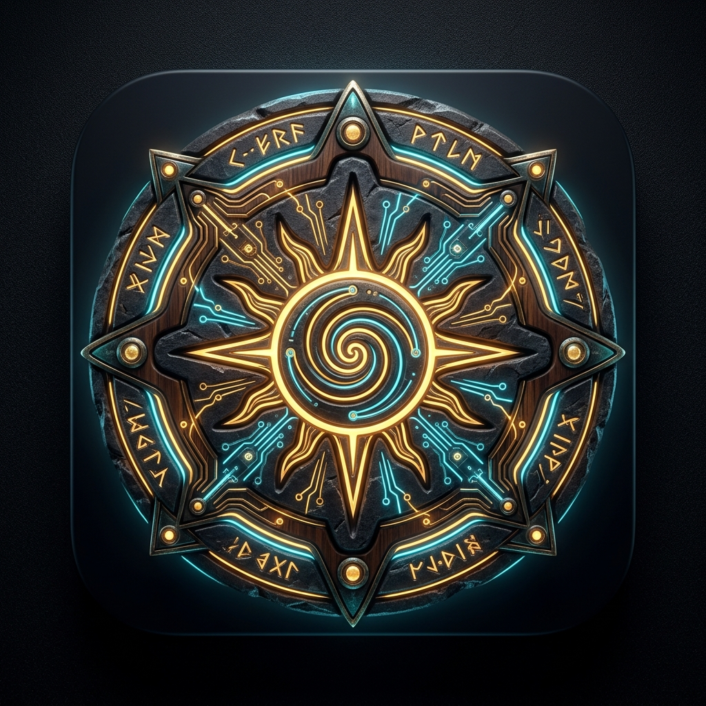
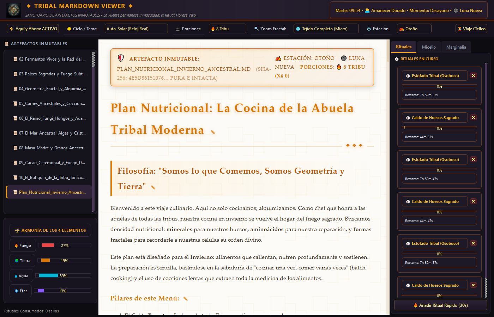
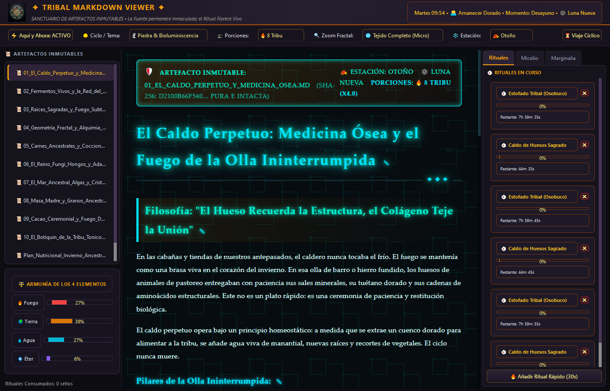
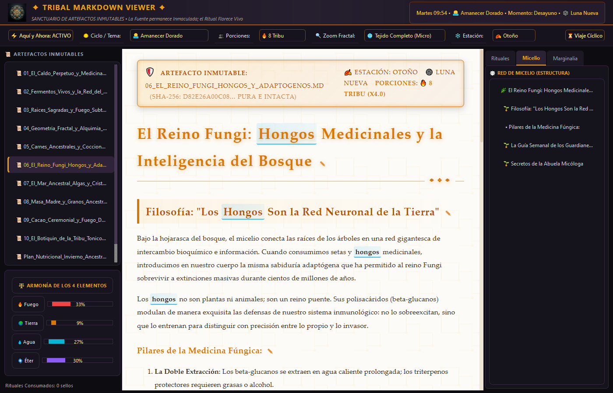
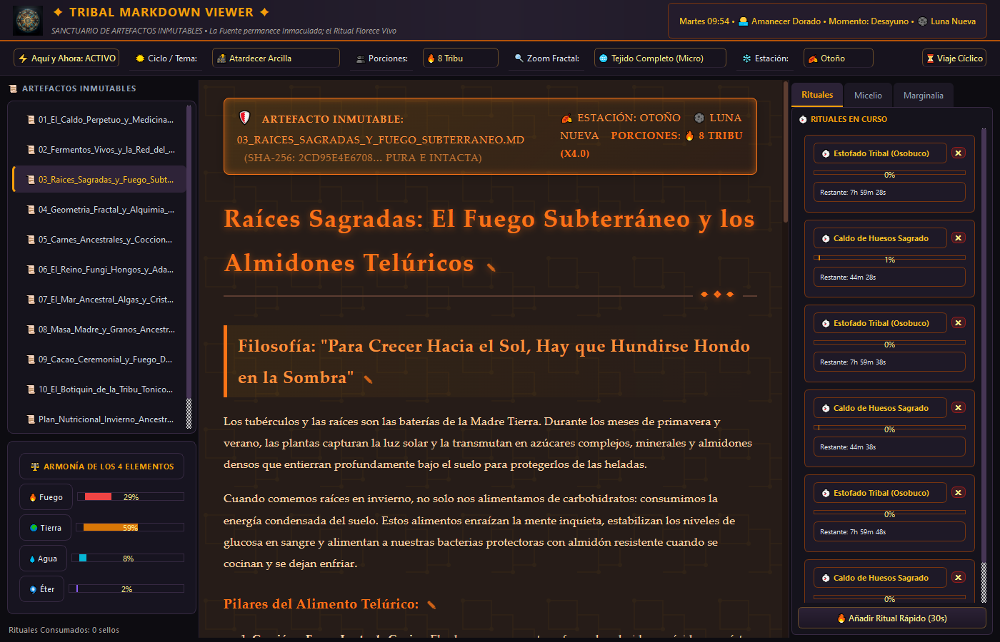
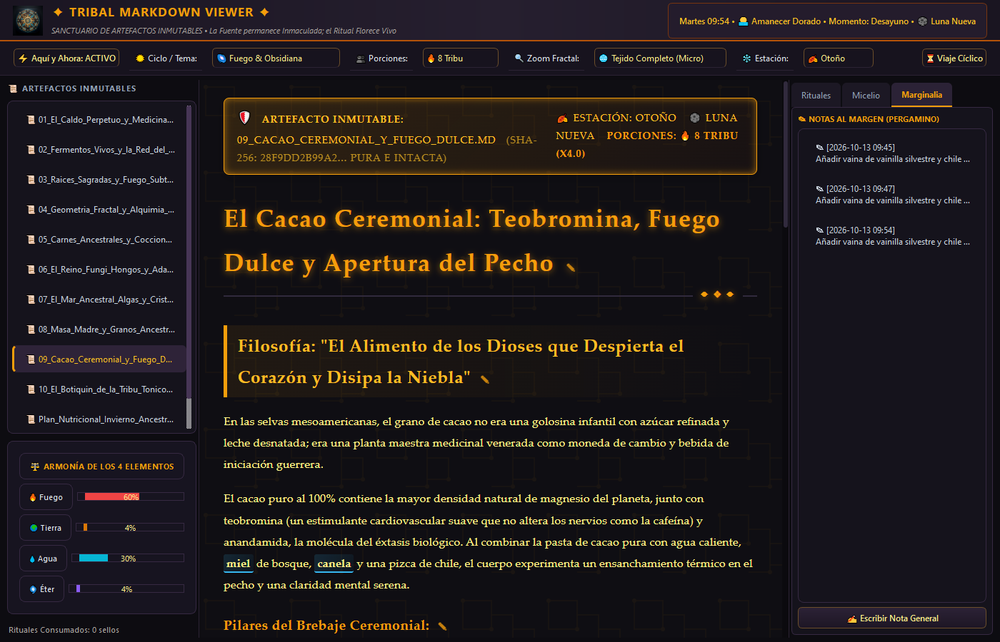
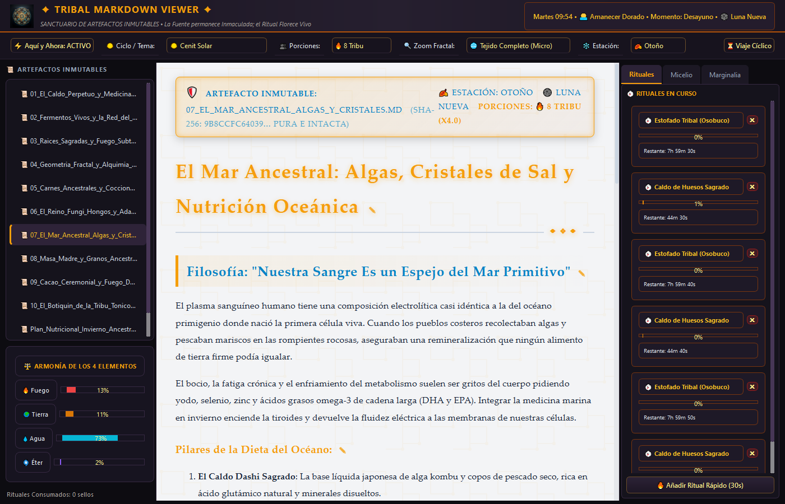

<p align="center">
  
</p>

<h1 align="center">✦ Tribal Markdown Viewer ✦</h1>

<p align="center">
  <strong>Sanctuario de Artefactos Inmutables: Sabiduría Ancestral & Fusión Cyber-Tribal</strong><br>
  <em>Un visor vivo para documentos eternos, combinando tecnología de circuitos, piedra y madera noble con ritmos circadianos y alquimia somática.</em>
</p>

<p align="center">
  
  
  
  
</p>

---

## 🏛️ Manifiesto de Inmutabilidad
> **«El Verbo permanece eterno; el Ritual florece vivo.»**  
> En este sanctuario, los archivos `.md` son **artefactos sagrados e inmutables**. Ninguna nota, marca de hábito, temporizador o interacción altera jamás un solo byte del archivo fuente original en disco (certificado por firma criptográfica **SHA-256**). Toda la vida emergente se superpone en capas reactivas no destructivas.

---

## 📸 Galería Visual del Sanctuario

### 1. Tema Principal: Reloj Natural / Auto-Solar en Tiempo Real
> El visor evoluciona automáticamente con la posición del sol y el momento biológico del día, iluminando las comidas del momento y activando la cámara de rituales.

<p align="center">
  
</p>

---

### 2. Tema: Piedra Rúnica & Circuitos Bioluminiscentes
> Basalto volcánico y piedra monolítica con circuitos tallados a cincel y letras grabadas que emiten resplandor fósforo cian/esmeralda.

<p align="center">
  
</p>

---

### 3. Tema: Amanecer Dorado & Navegación Fractal en Micelio
> Luz de aurora cálida, pergamino dorado y despliegue del árbol jerárquico de micelio para navegar fluidamente entre capítulos.

<p align="center">
  
</p>

---

### 4. Tema: Atardecer de Arcilla (Terracota & Cobre)
> Caoba profunda, arcilla caliente y atenuación de espectro azul con el tratado de raíces telúricas y medidor de elemento Tierra.

<p align="center">
  
</p>

---

### 5. Tema: Noche Profunda (Fuego Sagrado & Obsidiana) + Marginalia
> Cero luz azul para proteger la melatonina, madera quemada (*Yakisugi*), brasas vivas y cuaderno de notas al margen sin tocar el archivo Markdown.

<p align="center">
  
</p>

---

### 6. Tema: Cenit Solar (Piedra y Cobre)
> Claridad de mediodía de alto contraste, piedras areniscas, medidor de armonía de los 4 elementos y cronómetros de cocción en curso.

<p align="center">
  
</p>

---


## 🌀 Las 4 Paradojas Emergentes Implementadas

### 1. Texto Plano Inerte × Biología Metabólica / Cíclica
- **Modo «Aquí y Ahora»**: Detecta en tiempo real el día y la hora de la comida (ej. *Martes 14:00 $\rightarrow$ Almuerzo: Sobras del Estofado Tribal*), iluminando dinámicamente la fila con un pulso de circuitos ámbar y atenuando suavemente el resto del documento para foco bio-selectivo.
- **Reloj Solar Circadiano & Temas**:
  - ⏱️ **Auto-Solar (Reloj Real - Tema Principal)**: Sigue la hora exacta y ciclo del sol local.
  - 🗿 **Piedra Rúnica Bioluminiscente**: Basalto volcánico, circuitos tallados y letras grabadas con resplandor fósforo cian/esmeralda.
  - 🌅 **Amanecer Dorado (Aurora)**: Textura pergamino cálido y despertar metabólico.
  - ☀️ **Cenit Solar (Piedra & Cobre)**: Pizarra clara y alta agudeza diurna.
  - 🌇 **Atardecer de Arcilla (Terracota)**: Cobre y caoba, atenuación del espectro azul.
  - 🌌 **Fuego Sagrado & Obsidiana (Noche)**: Madera quemada (*Yakisugi*), brasas incandescentes y cero luz azul (protección de melatonina).
- **Filtros Estacionales y Lunares**: Resalta ingredientes y preparaciones afines a la estación seleccionada junto a la fase lunar en curso.
- **Viaje Cíclico**: Simulador temporal para explorar cualquier día y momento sin alterar el reloj del sistema.

### 2. Lectura Pasiva (Pantalla) × Acción Somática / Alquimia Física
- **Cronómetros de Cocción Embebidos**: El motor detecta expresiones de tiempo (*"8 horas"*, *"45 minutos"*, *"24 horas"*, *"la noche anterior"*) y las convierte en botones de ritual activos (`⏱️ Iniciar Ritual`).
- **Campana Ceremonial Procedural**: Al concluir un ritual o sellar un hábito, el motor sintetiza una frecuencia armónica de cuenco tibetano (432Hz / 528Hz) mediante la Web Audio API, sin archivos de audio externos.
- **Escalado Dinámico de Porciones**: Selector en la cabecera (`1 Solitario/a` | `2 Pareja` | `4 Familia` | `8 Tribu`) que recalcula visualmente cantidades y proporciones en tablas al vuelo sin alterar el `.md`.
- **Sellos de Hábitos y Fermentación**: Sellos interactivos (`⭕` / `☀️`) para registrar recetas consumadas, persistidos en `.tribal_state.json`.

### 3. Scroll Lineal 2D × Geometría Sagrada / Espacial (Fractal)
- **Red de Micelio**: Despliega el árbol de encabezados como una red fractal navegable. Un clic transporta suavemente la lectura a la sección deseada.
- **Zoom Semántico**:
  - 🧬 **Semilla (Macro)**: Destilación filosófica (aforismos y pilares).
  - 🌿 **Ramas (Meso)**: Estructura de semanas y enfoques.
  - 🌐 **Tejido (Micro)**: Recetas completas, tablas y detalles exhaustivos.
- **Armonía de los 4 Elementos**: Analizador léxico que grafica el balance elemental del texto:
  - 🔥 **Fuego** (calor metabólico, estofados, cocción lenta)
  - 🌍 **Tierra** (densidad mineral, huesos, raíces)
  - 💧 **Agua** (hidratación, caldos, fermentos, mar)
  - 🌀 **Éter / Geometría** (fractales, espirales, patrones sagrados)

### 4. Perfección Digital Inmaculada × Entropía Orgánica (Pátina y Desgaste)
- **Pátina del Tiempo (Heatmap)**: Acumula noble desgaste en las secciones más leídas, reflejado en bordes dorados e insignias de *«✦ Consagrada»*.
- **Marginalia Sagrada**: Cuaderno lateral para añadir notas y reflexiones al margen atadas a cada sección sin ensuciar el código fuente Markdown.

---

## 📜 Biblioteca de Artefactos en `content/`

| Archivo | Temática Central | Elemento |
| :--- | :--- | :--- |
| `Plan_Nutricional_Invierno_Ancestral.md` | El plan maestro de invierno; caldos, geometría y enraizamiento óseo. | 🌍 Tierra / 🔥 Fuego |
| `01_El_Caldo_Perpetuo_y_Medicina_Osea.md` | Extracción mineral ininterrumpida de 48 horas, tuétano y colágeno. | 🌍 Tierra / 🔥 Fuego |
| `02_Fermentos_Vivos_y_la_Red_del_Micelio.md` | Chucrut de 21 días, kimchi, kéfir de leche cruda y la microbiota viva. | 💧 Agua / 🌀 Éter |
| `03_Raices_Sagradas_y_Fuego_Subterraneo.md` | Camote en cenizas, chirivías, remolacha y almidón resistente. | 🌍 Tierra |
| `04_Geometria_Fractal_y_Alquimia_Vegetal.md` | El Romanesco fractal, alcachofas concéntricas y cortes en espiral áurea. | 🌀 Éter |
| `05_Carnes_Ancestrales_y_Coccion_Lenta.md` | Honrar al animal (*nose-to-tail*); osobuco de 8 horas, hígado y corazón. | 🔥 Fuego / 🌍 Tierra |
| `06_El_Reino_Fungi_Hongos_y_Adaptogenos.md` | Shiitake, Melena de León, Chaga y Reishi en caldos medicinales. | 🌍 Tierra / 💧 Agua |
| `07_El_Mar_Ancestral_Algas_y_Cristales.md` | Caldo Dashi de Kombu, salmón a la sal gruesa y plasma marino isotónico. | 💧 Agua |
| `08_Masa_Madre_y_Granos_Ancestrales.md` | Fermentación de 48 horas de centeno y sarraceno para anular fitatos. | 🌍 Tierra / 🔥 Fuego |
| `09_Cacao_Ceremonial_y_Fuego_Dulce.md` | Cacao 100%, teobromina, miel silvestre y especias para abrir el pecho. | 🔥 Fuego / 🌀 Éter |
| `10_El_Botiquin_de_la_Tribu_Tonicos_y_Pociones.md` | Leche dorada de cúrcuma, Fire Cider, jarabe de saúco y oxímeles preventivos. | 🔥 Fuego / 💧 Agua |

---

## 🛠️ Estructura del Proyecto

```text
TribalMarkdownViewer/
├── assets/                                     # Capturas de pantalla de los temas
│   ├── ui_reloj_natural_principal.png
│   ├── ui_piedra_bioluminiscente.png
│   ├── ui_amanecer_dorado.png
│   ├── ui_noche_fuego_sagrado.png
│   └── ui_cenit_solar.png
├── content/                                    # Artefactos inmutables de lectura
│   ├── Plan_Nutricional_Invierno_Ancestral.md
│   ├── 01_El_Caldo_Perpetuo_y_Medicina_Osea.md
│   ├── ... (11 documentos en total)
│   └── .tribal_state.json                      # Capa no destructiva de estado y hábitos
├── tribal_engine/
│   ├── __init__.py
│   ├── state_manager.py                        # Persistencia y certificación SHA-256
│   ├── circadian.py                            # Reloj biológico, fases solares, luna y estaciones
│   ├── alchemy.py                              # Detección de tiempos, timers y escalado
│   ├── fractal.py                              # Red de micelio, zoom semántico y 4 elementos
│   ├── themes.py                               # Temas: Piedra bioluminiscente, Aurora, Cenit, Noche
│   └── renderer.py                             # Renderizador alquímico y Web Audio API
├── generate_screenshots.py                     # Capturador automatizado de capturas de pantalla
├── main.py                                     # Interfaz de escritorio PySide6
├── requirements.txt
└── README.md
```

## 🎮 Ejecución

```bash
# 1. Instalar dependencias (PySide6 y Markdown)
pip install -r requirements.txt

# 2. Iniciar el Sanctuario
python main.py
```
